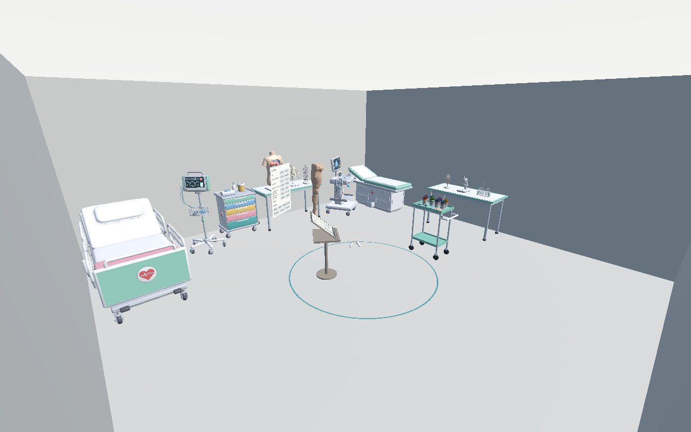
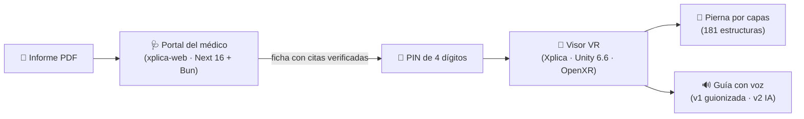

# 🦴 Xplica

**Espejo anatómico en realidad virtual para Meta Quest 3**

*El paciente ve su pierna por capas y una guía le explica solo lo que su médico registró.*

[-000000?style=for-the-badge&logo=unity&logoColor=white)](https://unity.com/)

[🦴 Visor (Unity)](https://github.com/DevFourYou/Xplica) · [🩺 Portal y backend](https://github.com/DevFourYou/xplica-web) · [📦 Releases](https://github.com/DevFourYou/Xplica/releases)

---

## 🧠 Qué es esto

**Xplica** transforma el informe médico tradicional en una experiencia clínica inmersiva. El paciente, sentado en un
consultorio virtual, ve frente a sí su pierna en 3D a escala real: **181 estructuras** organizadas en **7 capas
anatómicas** (piel, grasa, músculo, vasos y nervios, tendones y ligamentos, meniscos y cartílago, hueso), con su
lesión latiendo en el sitio exacto.

Puede agarrar el modelo, separar capas como si fueran láminas de anatomía y preguntarle a una **guía con voz
espacial** que le explica **únicamente** lo que su médico registró: el caso llega del portal web cuando el médico
sube su informe en PDF y abre una sesión con un **PIN de 4 dígitos**.

> [!IMPORTANT]
> **Principios de diseño clínico:** la guía **no diagnostica**, se trabaja **exclusivamente con casos ficticios**
> (Ley 29733), las llaves de IA **nunca salen del servidor** y las capas internas se inspeccionan por separación,
> nunca con transparencias apiladas.

---

## 🏗 Cómo se conecta todo

---

## 📦 Repositorios

| Repo | Qué es | Estado |
|---|---|---|
| **[`Xplica`](https://github.com/DevFourYou/Xplica)** | El visor VR en Unity 6.6: anatomía por capas, física, háptica, voz e IA | v0 cerrado · v1 en prueba · v3 por PIN ✅ |
| **[`xplica-web`](https://github.com/DevFourYou/xplica-web)** | El portal del médico y backend: informes PDF a ficha con citas verificadas y guía con IA | v0.1.0 ✅ · guía v2 lista en el backend |

<b>📊 Rendimiento del visor (optimización de la sesión 12)</b>

Medido con el Unity Profiler desde la vista del paciente, antes y después de optimizar:

| Métrica (peor cuadro) | Antes | Después | Mejora |
| :--- | :---: | :---: | :---: |
| **Objetos que proyectan sombra** | 437 | 76 | **-83 %** |
| **Triángulos** | 4.032.075 | 2.260.730 | **-44 %** |
| **Draw calls** | 926 | 556 | **-40 %** |
| **Memoria de texturas** | 419,8 MB | 285,2 MB | **-32 %** |
| **GC Alloc por cuadro** | 1,3 KB | 0,3 KB | **-77 %** |

Reporte completo: [`Xplica/Docs/optimizacion/Reporte_Optimizacion_Xplica.pdf`](https://github.com/DevFourYou/Xplica/blob/main/Docs/optimizacion/Reporte_Optimizacion_Xplica.pdf).

<b>🛡️ Seguridad y datos de salud</b>

- Pacientes e informes **ficticios siempre**: la información de salud es dato sensible (Ley 29733, Perú).
- La guía **no diagnostica**: en v2, cada frase generada se verifica contra el caso antes de sonar; si falla, se
  reemplaza por una frase segura.
- Las llaves de DeepSeek y ElevenLabs viven **solo en el servidor** del portal: ninguna respuesta las devuelve y
  nunca llegan al visor.
- El informe en PDF se lee **dentro del servidor** (`pdf-inspector`): no viaja a ningún tercero.

---

## 👥 Equipo

Proyecto del curso **Desarrollo de Videojuegos con Realidad Aumentada y Virtual**:

| Integrante | GitHub |
| :--- | :---: |
| **Deyvi Oscar Sanchez Gonzales** |  |
| **Max Anderson Ttito Pomacanchari** |  |
| **Felipe Inga Silva** |  |
| **Angel Fabian Choquehuanca Capia** |  |
