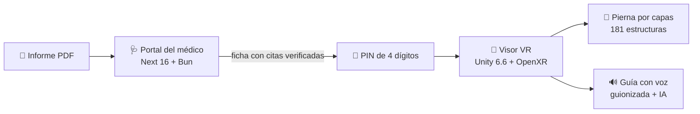

 

## 👋 Somos Dev4You

Somos **cuatro desarrolladores** que convierten problemas reales en software que se puede **ver, tocar y entender**.
Juntamos realidad virtual, desarrollo web full-stack e inteligencia artificial para que la tecnología explique,
no confunda.

<table>
  <tr>
    <td align="center" width="33%">
      <h3>🥽</h3>
      <b>Realidad virtual</b> 
      Experiencias inmersivas en Unity para Meta Quest 3, con física, háptica y voz espacial.
    </td>
    <td align="center" width="33%">
      <h3>🌐</h3>
      <b>Web full-stack</b> 
      Portales y backends rápidos con Next.js, TypeScript y Bun, listos para producción.
    </td>
    <td align="center" width="33%">
      <h3>🤖</h3>
      <b>IA responsable</b> 
      Modelos que explican solo lo verificado, con las llaves siempre del lado del servidor.
    </td>
  </tr>
</table>

## 🚀 Proyecto destacado: Xplica

<table>
  <tr>
    <td width="52%" valign="middle">
      
    </td>
    <td width="48%" valign="middle">
      <h3>🦴 Espejo anatómico en VR</h3>
      
El paciente se sienta en un consultorio virtual y ve <b>su propia pierna en 3D</b>, a escala real, con la lesión marcada en el sitio exacto. Separa las capas como láminas de anatomía y una <b>guía con voz</b> le explica solo lo que su médico registró.

      

        
        
        
      

      

        <a href="https://github.com/DevFourYou/Xplica"><b>🥽 Visor VR</b></a> ·
        <a href="https://github.com/DevFourYou/xplica-web"><b>🩺 Portal y backend</b></a> ·
        <a href="https://github.com/DevFourYou/Xplica/releases"><b>📦 Releases</b></a>
      

    </td>
  </tr>
</table>

> [!IMPORTANT]
> **Diseño clínico responsable:** la guía **no diagnostica**, trabajamos **solo con casos ficticios** (Ley 29733) y las
> llaves de IA **nunca salen del servidor**.

<b>🏗️ Cómo se conecta todo</b>

 

<b>📊 Rendimiento del visor</b>

 

Medido con Unity Profiler desde la vista del paciente, antes y después de optimizar:

| Métrica (peor cuadro) | Antes | Después | Mejora |
| :--- | :---: | :---: | :---: |
| Objetos que proyectan sombra | 437 | 76 | **−83 %** |
| Triángulos | 4.032.075 | 2.260.730 | **−44 %** |
| Draw calls | 926 | 556 | **−40 %** |
| Memoria de texturas | 419,8 MB | 285,2 MB | **−32 %** |
| GC Alloc por cuadro | 1,3 KB | 0,3 KB | **−77 %** |

## 🛠️ Stack

  

## 👥 El equipo

<table>
  <tr>
    <td align="center" width="25%">
       
      <b>Deyvi Sánchez</b> 
      <a href="https://github.com/IvyedSG">@IvyedSG</a>
    </td>
    <td align="center" width="25%">
       
      <b>Max Ttito</b> 
      <a href="https://github.com/ander0code">@ander0code</a>
    </td>
    <td align="center" width="25%">
       
      <b>Felipe Inga</b> 
      <a href="https://github.com/DiegoInga">@DiegoInga</a>
    </td>
    <td align="center" width="25%">
       
      <b>Angel Choquehuanca</b> 
      <a href="https://github.com/AngelCh0">@AngelCh0</a>
    </td>
  </tr>
</table>

