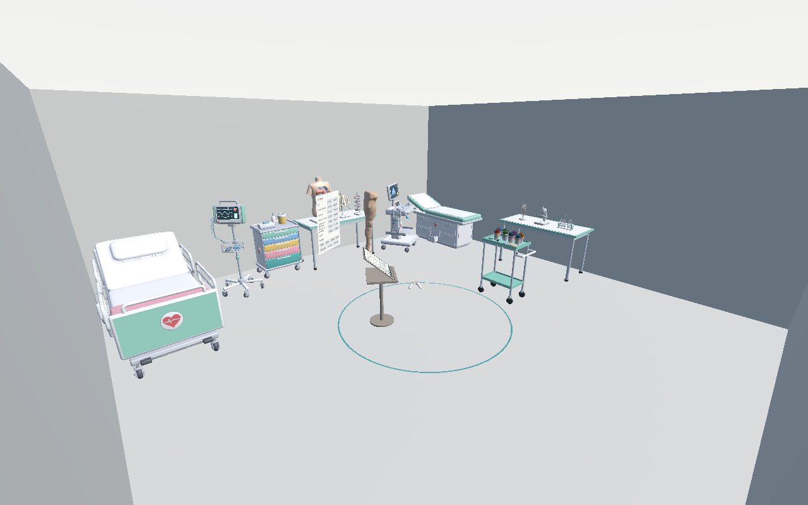
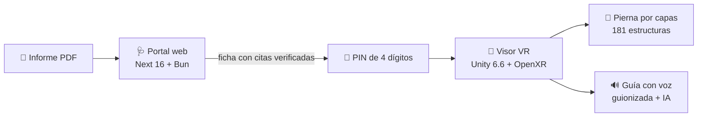

 

## 👋 Quiénes somos

Somos **cuatro estudiantes de carrera** en Lima, Perú. Usamos esta organización como **equipo de estudio** para juntar
los proyectos que desarrollamos en los cursos de la universidad y probar ideas que mezclen realidad virtual,
desarrollo web e inteligencia artificial.

<table>
  <tr>
    <td align="center" width="33%">
      <h3>🥽</h3>
      <b>Realidad virtual</b> 
      Escenas 3D, física, háptica y audio espacial en Unity para Meta Quest 3.
    </td>
    <td align="center" width="33%">
      <h3>🌐</h3>
      <b>Desarrollo web</b> 
      Interfaces y APIs con Next.js, TypeScript y Bun para conectar todo desde el navegador.
    </td>
    <td align="center" width="33%">
      <h3>🤖</h3>
      <b>IA aplicada</b> 
      Integración de modelos de lenguaje y voz para acompañar cada proyecto de estudio.
    </td>
  </tr>
</table>

## 🚀 Proyecto de curso: Xplica

<table>
  <tr>
    <td width="52%" valign="middle">
      
    </td>
    <td width="48%" valign="middle">
      <h3>🦴 Espejo anatómico en VR</h3>
      
Proyecto para el curso <b>Desarrollo de Videojuegos con Realidad Aumentada y Virtual</b>. El usuario entra a un consultorio virtual, ve una pierna en 3D a escala real, separa sus capas anatómicas y escucha a una guía explicar el caso cargado con un PIN desde el portal web.

      

        
        
        
      

      

        <a href="https://github.com/DevFourYou/Xplica"><b>🥽 Visor VR</b></a> ·
        <a href="https://github.com/DevFourYou/xplica-web"><b>🩺 Portal web</b></a> ·
        <a href="https://github.com/DevFourYou/Xplica/releases"><b>📦 Releases</b></a>
      

    </td>
  </tr>
</table>

> [!NOTE]
> **Trabajo académico:** todos los casos e informes usados en las pruebas son ficticios (Ley 29733), la guía no
> diagnostica y los repositorios de código del proyecto son privados mientras dura el curso.

<b>🏗️ Cómo se conecta todo</b>

 

<b>📊 Optimización del visor (Unity Profiler)</b>

 

Comparación desde la vista del usuario antes y después de optimizar la escena para Quest 3:

| Métrica (peor cuadro) | Antes | Después | Mejora |
| :--- | :---: | :---: | :---: |
| Objetos que proyectan sombra | 437 | 76 | **−83 %** |
| Triángulos | 4.032.075 | 2.260.730 | **−44 %** |
| Draw calls | 926 | 556 | **−40 %** |
| Memoria de texturas | 419,8 MB | 285,2 MB | **−32 %** |
| GC Alloc por cuadro | 1,3 KB | 0,3 KB | **−77 %** |

## 🛠️ Con qué trabajamos

  

## 👥 El equipo

<table>
  <tr>
    <td align="center" width="25%">
       
      <b>Deyvi</b> 
      Sánchez 
      <a href="https://github.com/IvyedSG">@IvyedSG</a>
    </td>
    <td align="center" width="25%">
       
      <b>Max</b> 
      Ttito 
      <a href="https://github.com/ander0code">@ander0code</a>
    </td>
    <td align="center" width="25%">
       
      <b>Felipe</b> 
      Inga 
      <a href="https://github.com/DiegoInga">@DiegoInga</a>
    </td>
    <td align="center" width="25%">
       
      <b>Angel</b> 
      Choquehuanca 
      <a href="https://github.com/AngelCh0">@AngelCh0</a>
    </td>
  </tr>
</table>

